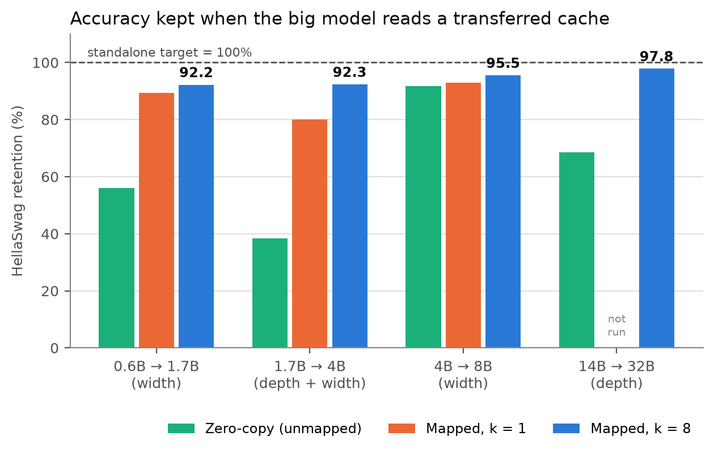

# Cross-Model KV Cache Transfer in the Qwen3 Family

A replication and extension of Heo et al. (NVIDIA), **"Cross-Model KV Cache Transfer in LLM
Families: A Closed-Form Linear Mapping for Prefill Reuse"**
([arXiv 2608.03893](https://arxiv.org/html/2608.03893v1)).

A small model reads the prompt. A ridge regression, fitted in closed form per layer and KV
head, maps its KV cache into a larger model's format. The larger model then answers without
running prefill. This repo tests that on four Qwen3 pairs, from 0.6B → 1.7B (smaller than
anything in the paper) up to the paper's own 14B → 32B.

---

## Results

HellaSwag, all 10,042 questions, zero-shot, acc_norm. **Retention** = accuracy with the mapped
cache ÷ the large model's own accuracy. Every mapper uses the same protocol: 500 × 1,024
FineWeb-Edu calibration tokens, all-heads features, λ = 0.01.

| Pair | Layers | Hidden size | Zero-copy | k = 1 | **k = 8** | Held-out key R² (k = 8) |
|---|---|---|---:|---:|---:|---:|
| 0.6B → 1.7B | 28 → 28 | 1,024 → 2,048 | 56.1% | 89.3% | **92.2%** | 0.710 |
| 1.7B → 4B | 28 → 36 | 2,048 → 2,560 | 38.4% | 80.0% | **92.3%** | 0.707 |
| 4B → 8B | 36 → 36 | 2,560 → 4,096 | 91.8% | 92.9% | **95.5%** | 0.752 |
| 14B → 32B | 40 → 64 | 5,120 → 5,120 | 68.4% | not run | **97.8%** | 0.730 |

- **k** is the number of small-model layers each large-model layer reads from.
- **Zero-copy** pastes the small model's cache in unmapped. It's the baseline the mapper has
  to beat.
- Every k = 8 vs zero-copy and k = 8 vs k = 1 gap is significant on a paired test
  (`scripts/08_paired_test.py`). The weakest is +1.8 points, p = 3e−14.

What the pairs show:

1. **The method replicates.** On 14B → 32B, k = 8 scores 80.93 acc_norm, against the paper's
   80.70.
2. **It works below 3B.** Both small pairs keep about 92%.
3. **At equal depth, one layer does almost all the work.** Going from k = 1 to k = 8 adds
   about 2 points. When depth changes without shared weights (1.7B → 4B), it adds 8.4.
4. **14B → 32B is a special case.** Its `k_proj` weights show that the 32B's layers 0–31 are
   copies of 14B layers 0–31, and 32–63 are copies of 14B layers 8–39 (Fig 7). So its 97.8%
   may come from shared weights rather than size. **8B → 32B** (same target, different
   widths, so no copies are possible) is the run that separates the two. Its probe is in
   progress.



### Speedup: mapping a cache vs re-reading the prompt

Paper protocol: 64 to 32K tokens, 50 warmup and 30 timed runs, median
(`scripts/10_speedup.py`).

| Pair | GPU | 64 tokens | 1K | 8K | 32K | Paper |
|---|---|---:|---:|---:|---:|---|
| 14B → 32B, k = 8 | H100 PCIe | 5.6× | 13.1× | 15.7× | **21.8×** | 4.4× / 17× / 25.1× |
| 0.6B → 1.7B, k = 8 | L4 | 2.6× | 2.3× | 2.7× | out of memory | not reported |

- **These times assume the small model's cache already exists.** Counting the 14B's own
  prefill, the end-to-end gain on 14B → 32B is 1.6–2.1×.
- **Timing uses a mapper with random weights** of the fitted shape. It does the same
  arithmetic as a fitted one. The paper's Appendix G also times synthetic inputs.
- 8B → 32B was timed too (5.7–17.4×, in `results/speedup_h100/`), but it has no fitted
  mapper yet.

---

## Reproducing

### Setup

```bash
git clone https://github.com/autinn/kv-transfer && cd kv-transfer
uv venv --python 3.12 && source .venv/bin/activate
uv pip install -e ".[dev]"
source .env.sh                      # sets HF_HUB_DISABLE_XET=1
pytest tests/ -q -m "not slow"      # expect: 78 passed, no downloads
```

### 1. Smoke test (any machine, about 5 GB of downloads)

Runs every stage on 0.6B → 1.7B at toy size: 16 calibration sequences, 50 questions per
task. It checks that the pipeline runs. The numbers it prints are not results.

```bash
CONFIG=configs/smoke_0.6b_to_1.7b.yaml N_SEQS=16 DEVICE=mps bash scripts/run_all.sh   # or cpu / cuda
```

Pass condition: `standalone` and `oracle` are both 100.0 in the final table. The oracle feeds
the large model its own cache through the transfer path, so any gap there is a bug.

### 2. The small pair in full: 0.6B → 1.7B (one GPU, about 1.5 h)

This is the run behind the 0.6B → 1.7B row above. It was run on Modal:

```bash
pip install modal && modal setup
modal deploy modal_run.py
modal run modal_run.py::spawn_check --k 1                    # L4, ≤ 90 min, about $1
modal run modal_run.py::spawn_check --k 8 --gpu A100-40GB    # reuses the probe; the k=8 fit needs fp64
```

The first command captures both models' KV and runs the probe. It then fits k = 1 and scores
HellaSwag for standalone, oracle, zero-copy and k = 1. The second fits k = 8 and scores it.
Results land on the `kv-transfer-cache` volume at `results/eval_tasks.json`; fetch them with
`modal volume get kv-transfer-cache results/eval_tasks.json .`

On your own GPU (24 GB or more, about 100 GB of free disk), the same stages run with
`bash scripts/run_pair.sh configs/qwen3_0.6b_to_1.7b.a10.yaml`, which writes to `results/`.

Expected (the committed copy is `results/qwen3_0.6b_to_1.7b/eval_tasks.json`):

| Config | HellaSwag acc_norm | Retention |
|---|---:|---:|
| standalone | 0.6031 | 100% |
| oracle | 0.6031 | 100% |
| zero_copy | 0.3381 | 56.1% |
| mapper_k1_lam0.01_allheads | 0.5384 | 89.3% |
| mapper_k8_lam0.01_allheads | 0.5563 | 92.2% |

### 3. Larger pairs (one 80 GB GPU, 120 GB or more of disk)

```bash
bash scripts/run_pair.sh configs/qwen3_1.7b_to_4b.yaml   # about 1.3 h
bash scripts/run_pair.sh configs/qwen3_4b_to_8b.yaml     # about 2 h
```

`run_pair.sh` runs probe → fit (k = 1 and 8) → held-out R² → HellaSwag → paired test, and
resumes from whatever is already on disk. For 14B → 32B, use
`configs/qwen3_14b_to_32b_replication.yaml` (see [GPU.md](GPU.md)).

### Fitted mappers

The fitted mappers are 0.24–2.4 GB each, too large for git. They're on Hugging Face at
[autinnn/qwen3-kv-transfer-mappers](https://huggingface.co/autinnn/qwen3-kv-transfer-mappers):
0.6B → 1.7B (k = 1 and 8), 1.7B → 4B (k = 8) and 4B → 8B (k = 8). Score one without refitting:

```bash
python scripts/07_eval_tasks.py --config configs/qwen3_4b_to_8b.yaml --tasks hellaswag \
  --mappers <downloaded .pt>
```

The 14B → 32B mapper isn't published.

### Figures

`python scripts/09_writeup_figures.py` rebuilds every figure in `results/plots/writeup/` from
the committed results (no GPU, about a minute).

| Figure | What it shows |
|---|---|
| `fig1_retention.png` | Retention per pair: zero-copy, k = 1, k = 8 |
| `fig2_alignment.png` | Best small-model layer for each large-model layer |
| `fig3_probe_heatmaps.png` | Single-layer key R² for every layer pair, four pairs |
| `fig4_heads.png` | Same-head vs all-heads features |
| `fig5_heldout_r2.png` | Mapper fit on training text vs held-out text |
| `fig6_speedup.png` | Latency and speedup vs prompt length |
| `fig7_lineage.png` | 14B → 32B: probe R² next to the cosine of the raw `k_proj` weights |

---

## Method

For each large-model layer *l* and KV head *h*, fitted with RoPE removed:

```
K̂ = (K_s · R_s⁻¹ · W_K + b_K) · R_t      keys: un-rotate, map, re-rotate
V̂ =  V_s · W_V + b_V                     values carry no position
W = (XᵀX + λI)⁻¹ XᵀY,  λ = 0.01           X = all 8 KV heads of the top-k small-model layers
```

1. **Probe.** Fit a one-layer map for every (small layer, large layer, head) and record R².
   This ranks which small-model layers to read from.
2. **Fit.** Concatenate the top-k layers per large-model layer and solve the ridge regression
   from `XᵀX` and `XᵀY`, accumulated shard by shard. The design matrix is never built.

Two details that are easy to get wrong, both covered by tests:

- **RoPE convention.** Qwen3 rotates dimension *i* with *i + D/2* (NeoX style), not adjacent
  pairs. The wrong convention still runs and gives plausible numbers.
  `tests/test_rope.py` checks against Hugging Face's implementation.
- **Where to capture keys.** Qwen3 normalises keys before RoPE, so the hook sits on `k_norm`.
  `tests/test_identity.py` maps a model onto itself and must reproduce its logits (measured
  error: 2.9e−05).

Any two dense Qwen3 models can be paired: all have 8 KV heads of dimension 128, the same
RoPE base and the same tokenizer.

---

## Layout

```
src/kvtransfer/   rope, capture, kvstore (KV to disk once), batched_gram + stream (Gram
                  accumulators), ridge, select (top-k), mapper, graft, eval/, bench
scripts/
  02_probe_r2.py           probe: R² for every layer pair
  03_fit.py                fit mappers at each k (--all-heads, --holdout-shards)
  04_report_probe.py       probe → text report
  07_eval_tasks.py         benchmark retention
  08_paired_test.py        paired significance test
  09_writeup_figures.py    all figures
  10_speedup.py            transfer vs re-prefill latency
  11_weight_similarity.py  k_proj weight cosine between two models (Fig 7)
  12_failure_examples.py   which questions the mapper loses
  run_all.sh / run_pair.sh full pipelines
configs/          one YAML per pair (models, calibration, devices, λ, k, tasks)
tests/            fast unit tests + slow end-to-end guardrails (-m slow)
```

---

## Status

| Part | State |
|---|---|
| Pipeline and guardrails | done |
| 14B → 32B replication | done: 97.8% at k = 8 |
| Four-pair family matrix | done |
| Speedup, 14B → 32B and 0.6B → 1.7B | done |
| 8B → 32B probe (scale vs shared weights) | running |
| Write-up | in progress |
